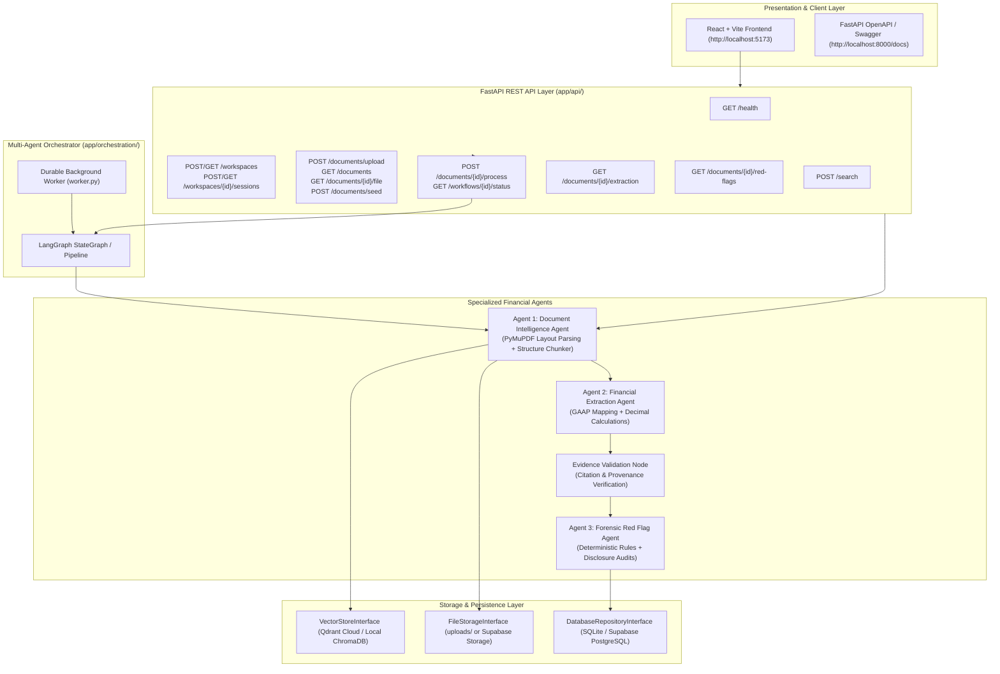

# Multi-Agent Financial Research System
**Infosys Springboard — Vidzai Digital**  
**Milestone 1 & Milestone 2 Implementation: Complete Foundation, Document Intelligence, Financial Extraction, Red Flag Forensic Audits, and LangGraph Orchestration**

---

## 1. Project Overview

The **Multi-Agent Financial Research System** is an enterprise-grade AI solution engineered to ingest, parse, analyze, benchmark, and report on complex corporate financial disclosures:
- **Annual Reports & Statutory Disclosures** (e.g., Integrated Annual Reports, Auditor Reports, Notes to Accounts).
- **Financial Statements** (Consolidated and Standalone Balance Sheets, Statements of Profit and Loss, Cash Flow Statements).
- **SEC Filings** (Form 10-K Annual Reports, Form 10-Q Quarterly Reports).
- **Earnings Call Transcripts** (Executive management commentary, financial reviews, analyst Q&A).

### Core Directive: Strict Source Grounding & Zero Hallucination
- Every extracted financial figure, calculated ratio, and forensic risk finding is bound to an exact source document and verifiable page citation.
- Tabular financial structures are preserved to prevent column/row misalignment.
- Deterministic financial mathematics mandate Python `Decimal` rather than LLM arithmetic.
- Qualitative disclosure audits detect auditor qualifications, going-concern uncertainties, and debt/margin deterioration.

---

## 2. Implemented Architecture & Agents



---

## 3. Technology Stack

| Layer | Component | Description |
|---|---|---|
| **Web API** | FastAPI + Uvicorn | Asynchronous Python REST API with OpenAPI documentation |
| **Frontend** | React 18 + Vite | Analyst dashboard, document library, and analytical workspace |
| **PDF Parsing** | PyMuPDF (fitz) | High-speed layout parsing and Markdown table extraction |
| **Embeddings** | OpenAI Embeddings (`text-embedding-3-small`, 1536-dim) / Local MiniLM (`all-MiniLM-L6-v2`, 384-dim) | Dense vector generation for semantic cosine retrieval |
| **Vector DB** | Qdrant / ChromaDB | Qdrant REST client with automatic persistent ChromaDB fallback |
| **Relational DB** | SQLite (`documents.db`) / Supabase PostgreSQL | Tables for documents, metrics, evidence, red flags, jobs, and runs |
| **Orchestration** | LangGraph / Typed State Machine | Sequential agent execution with durable job tracking |
| **Reasoning LLM** | OpenAI `gpt-6.1-sol` (Responses API) / Mock | Structured parsing with Pydantic schemas and refusal handling |
| **Math Engine** | Python `Decimal` | Exact accounting precision with zero floating-point drift |

---

## 4. Quick Start & Execution Guide (Windows PowerShell)

### Step 1: Backend Setup & Seed Ingestion
Open **Terminal 1**:
```powershell
# Navigate to backend directory
cd c:\Users\adina\Desktop\Infosys\document-agent

# Activate Python virtual environment
.\venv\Scripts\Activate.ps1

# Install / verify requirements
pip install -r requirements.txt

# Generate realistic multi-page financial seed PDFs (4 company filings)
python scripts\create_seed_pdfs.py

# Ingest and index seed filings into the Vector Database
python scripts\test_seed_ingestion.py

# Start the FastAPI Server on port 8000
python -m uvicorn main:app --host 127.0.0.1 --port 8000 --reload
```

### Step 2 (Optional): Start the Durable Background Job Worker
Open **Terminal 2**:
```powershell
cd c:\Users\adina\Desktop\Infosys\document-agent
.\venv\Scripts\Activate.ps1

# Start the persistent database-backed job worker
python worker.py
```

### Step 3: Start the React + Vite Frontend
Open **Terminal 3**:
```powershell
# Navigate to frontend directory
cd c:\Users\adina\Desktop\Finanical-Research

# Start the development server
npm run dev
```
Open your browser at `http://localhost:5173`.

---

## 5. Automated Verification Test Suite

Run all test suites across Milestones 1 and 2 in **Terminal 4**:
```powershell
cd c:\Users\adina\Desktop\Infosys\document-agent
.\venv\Scripts\Activate.ps1

# 1. Document Agent, Parser, Chunker, Embedder, and Vector Store
python -m unittest tests\test_document_agent.py tests\test_parser.py tests\test_chunker.py tests\test_embedder.py tests\test_vector_store.py

# 2. Database Repositories, Workspaces, Sessions, and Job Claiming
python -m unittest tests\test_database.py

# 3. Extraction Agent, Normalizer, Python Decimal Calculations, and LLM Provider
python -m unittest tests\test_extractor.py tests\test_normalizer.py tests\test_calculations.py tests\test_llm_provider.py

# 4. Red Flag Rules, Disclosure Analyzer, and Evidence Validation
python -m unittest tests\test_red_flag_rules.py tests\test_red_flag_analyzer.py tests\test_validation.py

# 5. Multi-Agent Orchestration & End-to-End Pipeline
python -m unittest tests\test_orchestration.py tests\test_milestone2_e2e.py

# 6. Multi-Document Data Isolation & Zero Cross-Contamination Acceptance Test
python -m unittest tests\test_multi_document_isolation.py
```

---

## 6. Preloaded Financial Seed Documents

The system pre-populates 4 authentic corporate financial filings:
1. **Zenith Energy Resources Corp.** (`zenith_energy_earnings_call_q4_fy25.pdf`):
   - Q4 FY25 Earnings Call Transcript.
   - Revenue: $8,420M, Operating Cash Flow: $2,650M, Capital Expenditure: $1,120M, Total Debt: $3,800M.
2. **Acme Cloud Technologies, Inc.** (`acme_cloud_technologies_sec_10k_fy25.pdf` & `acme_tech_10k_fy25.pdf`):
   - SEC Form 10-K Annual Report.
   - Revenue: $14,300M, Gross Profit: $9,750M, Net Income: $1,184M, Total Assets: $18,600M.
3. **Apex Financial Holdings Group** (`apex_financial_holdings_annual_report_fy25.pdf`):
   - Annual Statutory Banking Report.
   - Basel III CRAR: 16.8%, CET1: 13.4%, Total Assets: $94,500M, Operating Profit: $4,630M.
4. **Infosys Limited** (`infosys_annual_report_fy24.pdf`):
   - Integrated Annual Report 2023-24.
   - Revenue from Operations: ₹153,670 Cr, Operating Profit: ₹31,747 Cr (20.7%), Net Profit: ₹26,248 Cr, Total Debt: 0 (Debt-free).

---

## 7. API Endpoints Reference

| Method | Path | Description |
|---|---|---|
| `GET` | `/health` | Live system readiness: DB, storage, vector store, embedding dimension, LLM status, worker queue |
| `POST` | `/workspaces` | Create a named research workspace |
| `GET` | `/workspaces` | List all research workspaces |
| `POST` | `/workspaces/{id}/sessions` | Create a named research session within a workspace |
| `GET` | `/workspaces/{id}/sessions` | List sessions belonging to a workspace |
| `POST` | `/documents/upload` | Upload PDF, deduplicate by SHA-256, parse, chunk, embed, index, and queue job |
| `GET` | `/documents` | List all ingested documents with metadata and page/chunk counts |
| `GET` | `/documents/{id}` | Retrieve document summary by ID |
| `GET` | `/documents/{id}/file` | Download/stream the original stored PDF binary |
| `POST` | `/documents/seed` | Ingest and index preloaded seed company documents |
| `POST` | `/documents/{id}/process` | Trigger sequential multi-agent analysis pipeline |
| `GET` | `/documents/{id}/status` | Query agent processing lifecycle status |
| `GET` | `/documents/{id}/extraction` | Retrieve extracted financial statement metrics and ratios |
| `GET` | `/documents/{id}/red-flags` | Retrieve detected forensic red flag risk findings and citations |
| `GET` | `/workflows/{job_id}/status`| Query execution status of a background processing job |
| `POST` | `/search` | Semantic cosine vector retrieval with page and table filters |
| `DELETE`| `/documents/{id}` | Safely remove document file, vectors, and database records |
