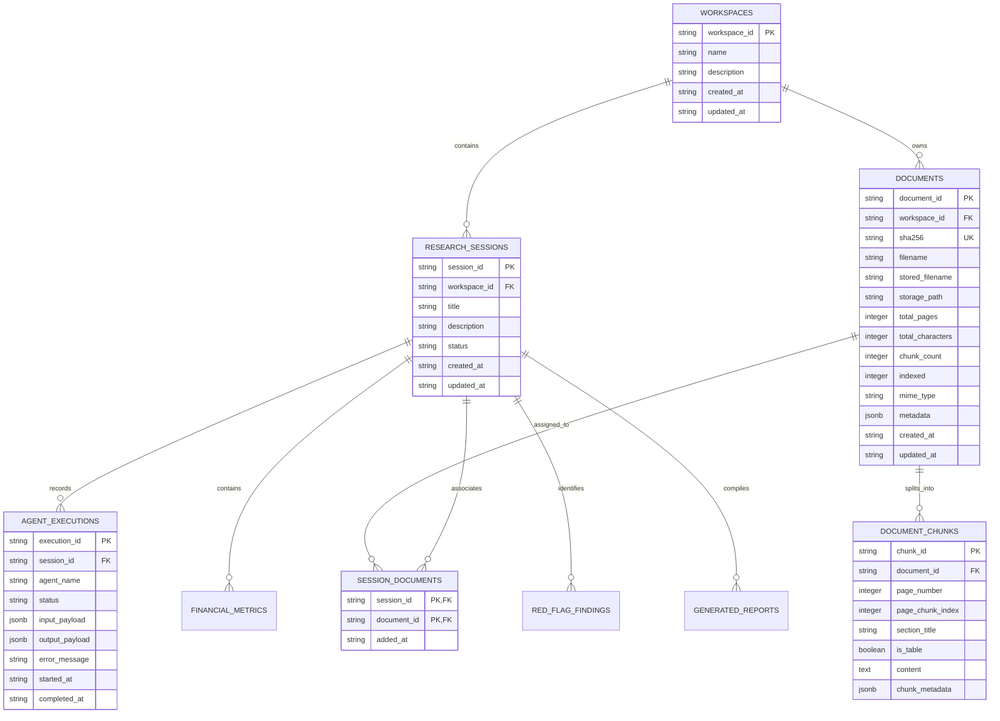

# Data Models & Schema Specifications
**Infosys Springboard — Vidzai Digital**  
**Milestone 1 Implementation & Future Agent Entity Schemas**

---

## 1. Relational Architecture (Supabase PostgreSQL / SQLite Dual-Mode)

The system is designed around a relational foundation connecting workspaces, research sessions, documents, and agent execution records.



---

## 2. Milestone 1 Core Models

### A. Workspaces Table (`workspaces`)
```sql
CREATE TABLE IF NOT EXISTS workspaces (
    workspace_id VARCHAR(64) PRIMARY KEY,
    name VARCHAR(255) NOT NULL,
    description TEXT,
    created_at TIMESTAMP WITH TIME ZONE DEFAULT CURRENT_TIMESTAMP,
    updated_at TIMESTAMP WITH TIME ZONE DEFAULT CURRENT_TIMESTAMP
);
```

### B. Research Sessions Table (`research_sessions`)
```sql
CREATE TABLE IF NOT EXISTS research_sessions (
    session_id VARCHAR(64) PRIMARY KEY,
    workspace_id VARCHAR(64) REFERENCES workspaces(workspace_id) ON DELETE CASCADE,
    title VARCHAR(255) NOT NULL,
    description TEXT,
    status VARCHAR(32) DEFAULT 'ACTIVE',
    created_at TIMESTAMP WITH TIME ZONE DEFAULT CURRENT_TIMESTAMP,
    updated_at TIMESTAMP WITH TIME ZONE DEFAULT CURRENT_TIMESTAMP
);
```

### C. Documents Table (`documents`)
```sql
CREATE TABLE IF NOT EXISTS documents (
    document_id VARCHAR(64) PRIMARY KEY,
    workspace_id VARCHAR(64) REFERENCES workspaces(workspace_id) ON DELETE SET NULL,
    sha256 VARCHAR(64) NOT NULL UNIQUE,
    filename VARCHAR(255) NOT NULL,
    stored_filename VARCHAR(255) NOT NULL,
    storage_path TEXT NOT NULL,
    total_pages INTEGER DEFAULT 0,
    total_characters INTEGER DEFAULT 0,
    chunk_count INTEGER DEFAULT 0,
    indexed INTEGER DEFAULT 0,
    mime_type VARCHAR(64) DEFAULT 'application/pdf',
    metadata JSONB DEFAULT '{}'::jsonb,
    created_at TIMESTAMP WITH TIME ZONE DEFAULT CURRENT_TIMESTAMP,
    updated_at TIMESTAMP WITH TIME ZONE DEFAULT CURRENT_TIMESTAMP
);
CREATE INDEX IF NOT EXISTS idx_documents_sha256 ON documents(sha256);
```

### D. Session Documents Join Table (`session_documents`)
```sql
CREATE TABLE IF NOT EXISTS session_documents (
    session_id VARCHAR(64) REFERENCES research_sessions(session_id) ON DELETE CASCADE,
    document_id VARCHAR(64) REFERENCES documents(document_id) ON DELETE CASCADE,
    added_at TIMESTAMP WITH TIME ZONE DEFAULT CURRENT_TIMESTAMP,
    PRIMARY KEY (session_id, document_id)
);
```

---

## 3. Vector Database Payload Schema (Qdrant / ChromaDB)

Each chunk indexed in Qdrant contains:

| Field | Type | Description |
|---|---|---|
| `id` | `UUID / string` | Deterministic chunk ID (`{document_id}-{chunk_index}`) |
| `vector` | `float[384]` | Normalized dense embedding vector from MiniLM |
| `payload.chunk_id` | `string` | Unique chunk identifier |
| `payload.document_id` | `string` | Parent document UUID |
| `payload.filename` | `string` | Original PDF filename |
| `payload.page_number` | `integer` | Source page number (1-indexed) |
| `payload.page_chunk_index` | `integer` | Chunk index on the specific page |
| `payload.section` | `string` | Section or heading (if extracted) |
| `payload.is_table` | `boolean` | Flag indicating structured table content |
| `payload.text` | `string` | Cleaned passage text (max ~350-400 tokens) |

---

## 4. Future Agent Entity Schemas (Milestones 2 & 3 Preview)

### A. Financial Metrics (`financial_metrics`)
- `metric_id`: Primary Key
- `document_id`: Foreign Key to `documents`
- `session_id`: Foreign Key to `research_sessions`
- `period_type`: `ANNUAL` | `QUARTERLY`
- `fiscal_year`: `2025`
- `statement_type`: `INCOME_STATEMENT` | `BALANCE_SHEET` | `CASH_FLOW`
- `is_consolidated`: Boolean
- `metric_name`: e.g., `REVENUE`, `NET_INCOME`, `TOTAL_DEBT`
- `raw_value`: Numeric string / Decimal
- `unit`: `INR_CRORES` | `USD_MILLIONS`
- `source_page`: Integer page reference
- `is_calculated`: Boolean
- `calculation_formula`: Optional derivation string

### B. Red Flag Findings (`red_flag_findings`)
- `finding_id`: Primary Key
- `session_id`: Foreign Key
- `document_id`: Foreign Key
- `category`: `DEBT` | `PROFITABILITY` | `CASH_FLOW` | `LIQUIDITY` | `AUDIT_QUALIFICATION` | `ACCOUNTING_POLICY`
- `severity`: `LOW` | `MEDIUM` | `HIGH` | `CRITICAL`
- `title`: Short descriptive title
- `description`: Detailed explanation of risk
- `evidence_quote`: Direct quoted passage
- `source_page`: Integer citation
- `fiscal_period`: e.g., `FY25-26`

