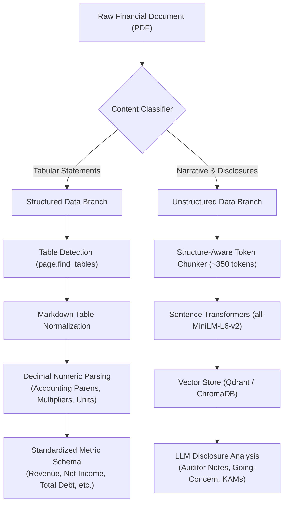

# Financial Document Structure Specification
**Infosys Springboard — Vidzai Digital: Multi-Agent Financial Research System**  
**Document Understanding, Layout Semantics & Extraction Taxonomy**

---

## 1. Objective and Scope

Financial research requires deep understanding of corporate disclosures. Unlike generic documents, financial filings blend dense tabular financial statements with nuanced narrative commentary, statutory notes, auditor opinions, and forward-looking guidance.

This specification documents the anatomy of four primary corporate document types:
1. **Company Annual Reports** (Statutory & Integrated Annual Reports).
2. **Financial Statements** (Stand-alone vs. Consolidated).
3. **SEC Form 10-K Filings** (U.S. GAAP Annual Disclosures).
4. **Earnings Call Transcripts** (Quarterly and Annual Investor Calls).

It defines which content is **structured** (requiring tabular extraction and mathematical precision) versus **unstructured/narrative** (requiring semantic chunking, context preservation, and LLM reasoning).

---

## 2. Anatomy of Financial Documents

### 2.1 Company Annual Reports
Annual reports represent the comprehensive yearly account of a company’s operational and financial condition.

| Document Section | Structure Type | Content & Semantic Characteristics | Processing Strategy |
|---|---|---|---|
| **Corporate Overview** | Narrative | Company profile, business model, mission, executive letters | Semantic chunking (~350 tokens) |
| **Management Discussion & Analysis (MD&A)** | Hybrid | Segment performance, operational headwinds, market trends, liquidity review | Semantic chunking + tabular metric extraction |
| **Auditor's Report** | Narrative | Audit opinion (Unqualified, Qualified, Adverse, Disclaimer), Basis for Opinion, Key Audit Matters (KAMs) | High-priority risk extraction (Red Flag Agent) |
| **Financial Statements** | Structured Table | Balance Sheet, Profit & Loss (P&L), Cash Flow Statement, Statement of Changes in Equity | Layout-aware table extraction (`page.find_tables()`) |
| **Notes to Financial Statements** | Hybrid | Accounting policies, breakdown of line items, debt schedules, contingent liabilities, related-party disclosures | Table parsing + cross-referencing footnotes to financial statement lines |
| **Corporate Governance & Statutory Disclosures** | Narrative | Director details, committee meetings, compliance certificates, litigation | Keyword search & risk disclosure analysis |

### 2.2 Financial Statements: The Core Three
Financial statements summarize operating performance, capital allocation, and solvency.

```
+-------------------------------------------------------------------------------+
|                           Core Financial Statements                           |
+------------------------------------+------------------------------------------+
| 1. Income Statement (P&L)          | Measures economic performance over period|
|    - Revenue from operations       | - Operating Expenses (OPEX)              |
|    - Cost of Goods Sold (COGS)     | - Operating Income / EBIT                |
|    - Gross Profit                  | - Net Profit & Diluted EPS               |
+------------------------------------+------------------------------------------+
| 2. Balance Sheet                   | Measures financial position at point     |
|    - Current & Non-Current Assets  | - Total Debt (Short-term & Long-term)    |
|    - Current Liabilities           | - Shareholders' Equity                   |
|    - Working Capital               | - Net Worth                              |
+------------------------------------+------------------------------------------+
| 3. Cash Flow Statement             | Reconciles cash generation & consumption |
|    - Cash from Operations (CFO)    | - Capital Expenditures (Capex)           |
|    - Cash from Investing (CFI)     | - Free Cash Flow (FCF = CFO - Capex)     |
|    - Cash from Financing (CFF)     | - Net Change in Cash                     |
+------------------------------------+------------------------------------------+
```

#### Consolidated vs. Standalone Statements
- **Consolidated Financial Statements**: Present the financial position and results of the parent company and all subsidiaries as a single economic entity. This is the primary basis for investment analysis and credit evaluation.
- **Standalone / Separate Financial Statements**: Present the financial results of the legal parent entity alone.
- *Strict Rule*: The AI service must explicitly label whether an extracted metric originates from a **Consolidated** or **Standalone** statement to prevent misleading comparisons.

### 2.3 SEC Form 10-K Filings
U.S. public companies file Form 10-K annually with the SEC. It follows a strictly regulated structure:
- **Item 1: Business** — Description of operations, products, and competitive landscape.
- **Item 1A: Risk Factors** — Disclosures of material investment risks, operational vulnerabilities, and regulatory threats (Primary source for Red Flag Agent).
- **Item 7: Management’s Discussion and Analysis (MD&A)** — Liquidity, capital resources, and results of operations.
- **Item 8: Financial Statements and Supplementary Data** — Audited balance sheets, statements of operations, cash flows, and notes.
- **Item 9A: Controls and Procedures** — Internal control over financial reporting; disclosures of material weaknesses.

### 2.4 Earnings Call Transcripts
Quarterly earnings calls consist of two distinct halves:
1. **Prepared Remarks (Executive Presentation)**: CEO and CFO present high-level quarterly revenue, EBITDA margins, cash flow, and forward-looking guidance.
2. **Question-and-Answer (Q&A) Session**: Financial analysts ask probing questions regarding margins, churn, pricing power, and competitive dynamics. Management responses often reveal candid qualitative color on underlying risks.

---

## 3. Structured vs. Unstructured Taxonomy

To guide the Document Agent and Extraction Agent:



---

## 4. Accounting Format Challenges & Handling Rules

Financial tables contain specific conventions that standard string extraction corrupts. The Extraction Agent applies strict parsing rules:

1. **Accounting Parentheses for Negative Values**:
   - Format: `(120)` or `(120.50)`
   - Meaning: Negative quantity `-120.00`.
   - Rule: Regex detects balanced parentheses around digits and prefixes a minus sign `-`.

2. **Reporting Units & Multipliers**:
   - In Indian reporting: *"In ₹ Crore"*, *"In ₹ Lakhs"*.
   - In US/Global reporting: *"In Millions of USD"*, *"In Thousands"*.
   - Rule: The table header or page heading multiplier is extracted and associated with the numerical value (`unit="CRORE"`, `unit="MILLION"`).

3. **Restated Financial Data**:
   - Companies frequently restate prior-year figures for accounting standard changes or mergers.
   - Rule: Prior-year numbers printed alongside current-year figures are marked with `is_restated=True` if designated in table notes.

4. **Missing Values vs. Zero**:
   - Dash (`-`), blank, or `N/A` often denotes "Not Applicable" or "Not Available", not numerical zero (`0.0`).
   - Rule: Missing entries are preserved as `None` / `null`. Never coerce missing values to `0.0`.

