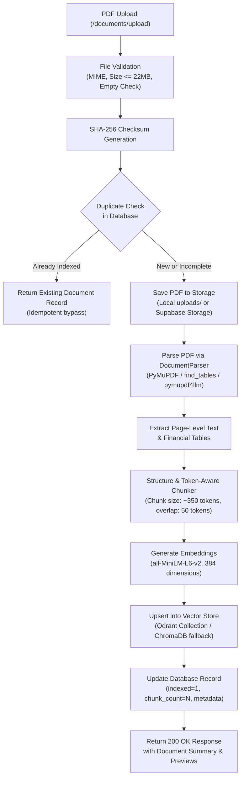

# System Architecture: Multi-Agent Financial Research System
**Infosys Springboard — Vidzai Digital**  
**Milestone 1 Implementation & Future Agent System Blueprint**

---

## 1. Executive Summary

The **Multi-Agent Financial Research System** is an enterprise-grade AI solution engineered to ingest, parse, analyze, benchmark, and report on complex corporate financial documents, including:
- Company Annual Reports (e.g., Integrated Annual Reports, Statutory Disclosures).
- Financial Statements (Consolidated and Standalone Balance Sheets, P&L, Cash Flows).
- SEC 10-K and 10-Q Filings.
- Earnings Call Transcripts and Investor Presentations.

The architecture strictly enforces **source grounding**, **deterministic financial calculations**, **verifiable page-level citations**, and **zero ungrounded fabrication**.

---

## 2. Architectural Layers

The system follows a modular, clean-architecture pattern dividing responsibilities into five layers:

```
+-----------------------------------------------------------------------------------+
|                           1. Presentation & API Layer                             |
|        FastAPI REST API  |  Swagger UI  |  CORS  |  Pydantic Request/Response     |
+-----------------------------------------------------------------------------------+
                                         |
+-----------------------------------------------------------------------------------+
|                        2. Agent Orchestration Layer                               |
|        LangGraph Stateful Graph  |  Shared Typed State  |  Validation Gates       |
+-----------------------------------------------------------------------------------+
       |                    |                    |                   |
+-----------------+  +-----------------+  +-----------------+  +-----------------+
| Document Agent  |  |Extraction Agent |  | Red Flag Agent  |  |Comparison Agent |
| (Milestone 1)   |  | (Milestone 2)   |  | (Milestone 2)   |  |  (Milestone 3)  |
+-----------------+  +-----------------+  +-----------------+  +-----------------+
                           |                                         |
                     +-----------------+                       +-----------------+
                     | Research Agent  |                       |  Report Agent   |
                     |  (Milestone 3)  |                       |  (Milestone 3)  |
                     +-----------------+                       +-----------------+
                                         |
+-----------------------------------------------------------------------------------+
|                      3. Infrastructure & Processing Services                      |
|  DocumentParserInterface (PyMuPDF / Docling)  |  Structure & Token-Aware Chunker  |
|  EmbeddingEngine (all-MiniLM-L6-v2 / BGE)    |  VectorStoreInterface (Qdrant/Chroma)|
+-----------------------------------------------------------------------------------+
                                         |
+-----------------------------------------------------------------------------------+
|                       4. Persistence & Storage Layer                              |
|  DatabaseInterface: Supabase PostgreSQL (SQLAlchemy/psycopg) + SQLite Local Store |
|  StorageInterface: Supabase Storage Bucket + Local File System Storage             |
|  VectorStore: Qdrant Vector DB (REST/Cloud) + ChromaDB (Local Persistent Engine)  |
+-----------------------------------------------------------------------------------+
```

---

## 3. Ingestion Pipeline (Milestone 1 Document Agent)



---

## 4. Workspaces and Research Sessions Architecture

To fulfill Task 3 of Milestone 1, the architecture establishes a multi-tenant workspace and session hierarchy:

1. **Workspace**: A top-level container representing an organization, team, or project (e.g., *"Infosys Springboard Financial Analytics"*).
2. **Research Session**: A scoped research project within a workspace (e.g., *"FY25-26 Indian IT Sector Comparative Study"*).
3. **Session-Document Association**: Many-to-many relationship allowing uploaded documents to be assigned to one or more research sessions.
4. **Execution History**: Persists audit logs of agent executions within each session.

---

## 5. Storage & Database Strategy

### Primary Database: Supabase PostgreSQL with SQLite Dual-Mode
- **Production Mode**: Supabase PostgreSQL accessed via SQLAlchemy ORM / psycopg driver. Models use JSONB fields for flexible agent outputs, foreign keys for relational integrity, and indices on document hashes and session IDs.
- **Local Development / Fallback Mode**: Embedded SQLite repository (`documents.db`) supporting the exact same repository interface, guaranteeing zero-crash local execution without external cloud dependencies.
- **Migration Path**: Alembic migration scripts and SQL DDL defined in `migrations/`.

### Vector Store: Qdrant with ChromaDB Safe Migration Path
- **Primary Target**: Qdrant Vector Database via HTTP REST API (`/collections/{name}/points`).
  - Supports dense vectors, payload filtering by `document_id`, `page_number`, `session_id`, and `is_table`.
  - Configurable via `QDRANT_URL`, `QDRANT_API_KEY`, and `QDRANT_COLLECTION`.
- **Local Fallback**: ChromaDB persistent client (`chroma_db/`), ensuring existing collections (`financial_chunks`) are preserved and verified prior to decommissioning.

---

## 6. Security, Isolation, and Resource Efficiency

1. **Credential Safety**: Zero hardcoded secrets; externalized configuration via `.env` and `pydantic-settings`.
2. **Memory Efficiency**: Embedding models loaded as singletons (`lru_cache(maxsize=1)`); vector upserts batched in chunks of 250–500.
3. **Deterministic Arithmetic**: Future financial calculations (Extraction Agent) mandate Python `Decimal` to eliminate floating-point drift.
4. **Graceful Degradation**: Corrupted, password-protected, or image-only PDFs yield explicit error responses and diagnostic status without breaking the pipeline.

